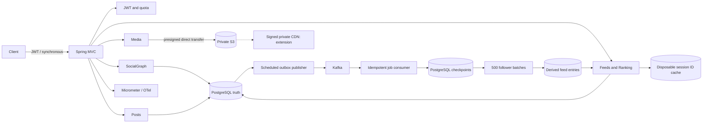
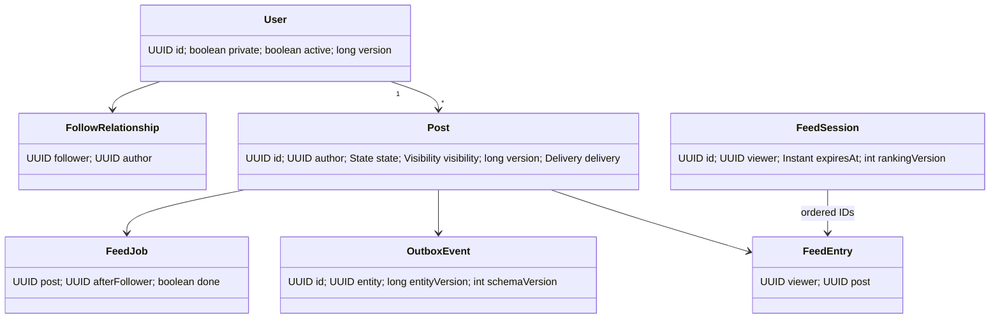
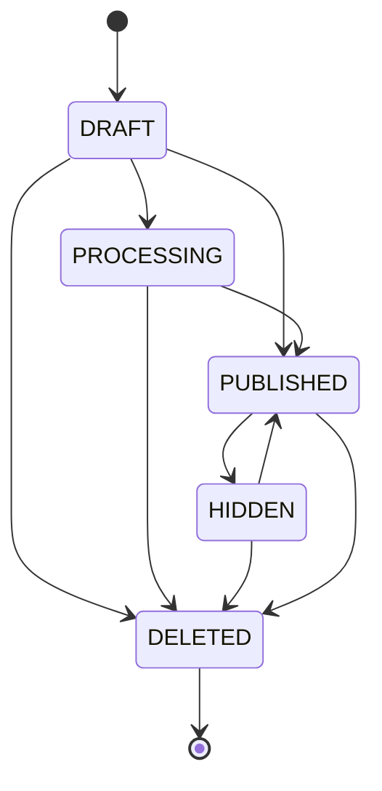

# Architecture and requirements

This is a runnable single-region modular application, not a validated billion-user deployment. Java 21, Boot 3.5.16,
MVC, JDBC, PostgreSQL, Redis, Kafka and S3 are selected. Boot dependencies are BOM-managed; AWS SDK 2.27.21 follows the
sibling repository. Java compatibility: https://docs.spring.io/spring-boot/3.5/system-requirements.html ; dependency
coordinates: https://docs.spring.io/spring-boot/3.5/appendix/dependency-versions/coordinates.html . SDK API
reference: https://sdk.amazonaws.com/java/api/2.27.21/software/amazon/awssdk/services/s3/S3Client.html . Versions still
need vulnerability scanning before deployment.

## Requirements and acceptance

OIDC/JWK RS256 authentication is available with pinned issuer/audience and production profile guards; local HMAC
issuance remains development-only. See [identity policy](identity.md). Authenticated profiles bootstrap from trusted
canonical UUID JWT subjects; no passwords are stored. Public/private profiles,
deactivation, follow requests, acceptance/rejection, follows, blocks, mutes, posts, comments, likes, media uploads and
immutable feed sessions are implemented. Home and profile feeds filter current truth. Chronological and explainable
ranked modes use a 1,000-item/15-minute session. IDs are UUIDv4 (probabilistic uniqueness with database constraints),
timestamps are PostgreSQL timestamptz. Captions/comments are plain text; clients must HTML-escape them. Profiles combine
identity/profile metadata in one users table to avoid an unnecessary join.

Acceptance is privacy under stale materialization; atomic post/outbox commit; idempotent key replay; uniqueness
constraints; worker checkpoints in the same transaction as inserts; optimistic update conflicts; bounded pagination with
no duplicate IDs; unavailable Redis reads fall back to PostgreSQL. These are local functional goals. Scale, SLO,
regional recovery and full abuse prevention require further validation.

## SLO proposals (unmeasured)

Publication: 99.9% successful requests durable within 500ms, excluding media; replay same key after timeout. Feed reads:
99.99% successful eligible reads and regional p99 <200ms, measured separately for session creation and continuation.
Freshness: 99% of push posts materialized for currently eligible followers within 5s, 99.9% within 60s; truth fallback
can surface posts sooner. Media: 99.95% successful authorized downloads, CDN TTFB p99 <150ms, with 30s capability
revocation window. Error budgets and scope must be agreed before claiming SLOs.

Application boundaries: Api is transport/validation, Security and RequestLimits protect ingress,
SocialGraph/Posts/Feeds/Media own application behavior, Store owns SQL and the shared visibility predicate, EventWorkers
owns integration and durable jobs, Contracts/Ranking contain domain rules. No empty repository interfaces are created;
Store is the explicit JDBC persistence boundary. Extract ports when an actual second adapter exists. Shared physical
schema is an intentional modular-monolith trade-off.

PROCESSING is a lifecycle reservation; no automatic video transcoder is included. Only DRAFT/PUBLISHED are accepted at
creation. Published media must be completed before attachment. DRAFT/HIDDEN posts are owner-editable but are not
available through the public post-read API. Editing requires exact version; terminal deletion cannot resurrect.

## Physical scaling extension

The baseline has no table partitioning: measurements should precede introducing partition keys that weaken global
constraints. Author-sharded posts optimize profile/pull reads but require fan-in across followed authors; post-ID
sharding optimizes point hydration but needs a separate author index. Viewer-sharded timelines optimize home feed and
distribute celebrity *readers*; graph needs both follower and author adjacency indexes, eventually separate sharded
representations with ordered edge events. Co-locate source author and outbox; candidate hydration must be bounded
scatter/gather with deadlines. PostgreSQL is truth; timelines and Redis are regenerable. No Cassandra/Elasticsearch is
justified locally.

Java virtual threads are deliberately off. MVC's bounded platform thread pool, Hikari 20 and statement timeouts make
overload visible. Virtual threads can reduce blocked-thread cost but do not increase DB capacity; introducing them
requires semaphore admission, pinning measurements, connection-wait metrics and a repeatable load improvement.
