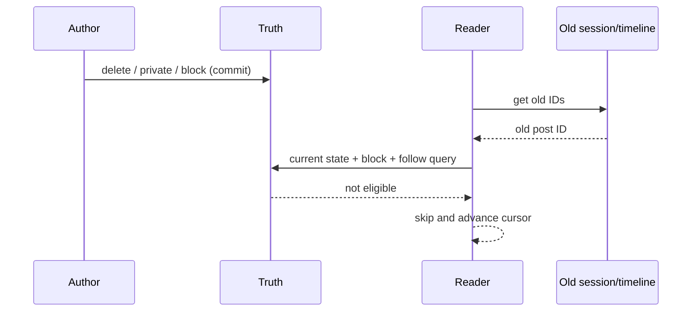

# Consistency, transactions and privacy

Following an already-approved private author is idempotent and does not reopen a pending request. Following an author
who has become public creates the edge and clears any obsolete pending request in the same transaction.

Posts and outbox share a transaction. Same actor/key + same content replays the committed result; different content
returns 409. A lost response is retried using the same key. Graph mutations lock the two users in UUID order; unique
edge keys prevent duplicates, blocks atomically remove both follow directions and requests. Accept/reject consumes the
pending request; unblock never restores follows. Private follow requests require explicit approval. A formerly public
follower remains approved when the author goes private. Mute hides home/profile feeds but does not revoke direct access.
Blocking works both ways; deactivation hides every authored post. Private profile name/count metadata remains visible
except to blocked users; private relationship lists are owner-only.

Like/unlike operations serialize on the post row; last successful serialization wins. Counts are SELECT COUNT truth with
indexed unique keys, so duplicate/out-of-order external events cannot corrupt counters (none are applied). This is
intentionally expensive for viral posts; shard counters with reconciliation only when proven necessary. Comments
soft-delete; repeated deletion is safe. Comment create is not idempotent on network retry; clients must not blindly
retry it. Deleted post engagement cannot be retrieved. Existing media attached to a deleted post fails new signed-link
requests.

Feed reads have PostgreSQL READ COMMITTED statement snapshots. Visibility is checked at the hydration statement against
post state, author active/private flags, blocks and approved follows. A permission change committed before that
statement is observed. In-flight responses authorized just before a concurrent revocation may complete; there is no
impossible promise to retract bytes already delivered. Viewer active checks occur at request start. Cached IDs, pushed
entries and stale events cannot bypass the SQL predicate.

Read-your-own PUBLISHED posts works via truth fallback after creation. Fan-out is eventual, timeline retention seven
days; old materializations may be missing without losing posts. Sessions expire at 15 minutes. Sessions surviving worker
crashes remain durable. Deleted posts remain tombstoned until a privacy retention/purge process is deployed. Current
implementation does not hard-delete personal data automatically; production launch is gated on retention policy and
purge tooling.

## Multi-region extension

Start single-region multi-AZ managed PostgreSQL primary, synchronous AZ failover, Redis replicas, Kafka RF3/min ISR2.
Compose is single-node development only. Active-passive adds asynchronous replicated post data and warm infrastructure,
explicit promotion fencing, measured RPO (e.g. <60s proposed) and RTO (<30min proposed). Active-active requires
home-region ownership per user, globally unique UUIDs, replicated immutable posts and separate graph/privacy authority.
Region-local timelines rebuild from truth/events. Do not accept graph mutations concurrently in multiple regions without
conflict semantics.

Asynchronous replication cannot immediately enforce global privacy revocation. Remote regions must consult the
home-region authorization authority or hold short, fenced permission leases whose revocation delay is an explicit
product contract. During partition, fail closed for private/uncertain authorization; returning stale public cache is
unsafe after a possibly unreplicated privacy change. Region failover requires fencing old writers and verifying privacy
watermark before serving. Media signed URLs remain usable up to 30s; immediate revocation requires an authorization
gateway at every fetch, CDN token revocation and cache purge. Residency affects graph replication, logs and analytics,
not just S3 bucket placement.
