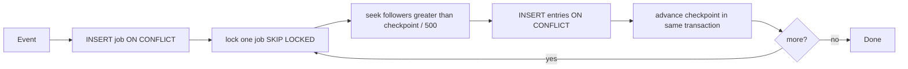
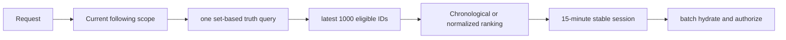
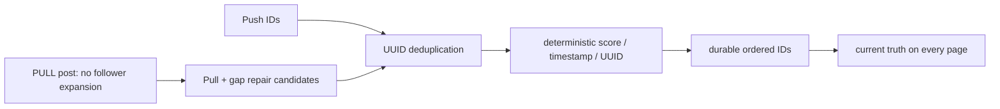
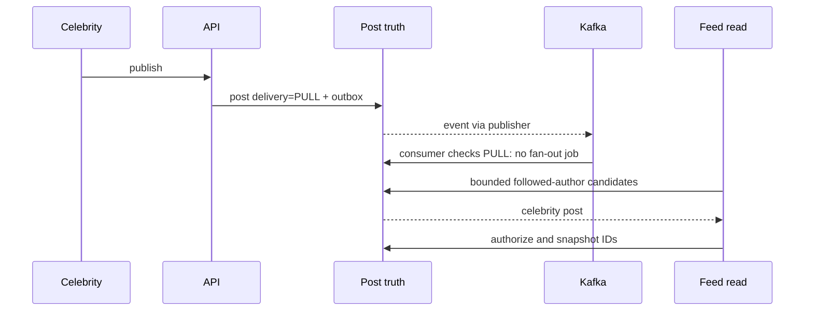
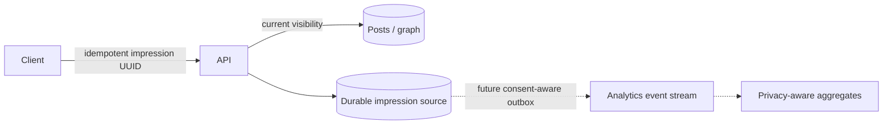

# Publication, delivery, ranking and pagination

```mermaid
sequenceDiagram
 participant C as Client
 participant A as API
 participant P as PostgreSQL
 participant W as Outbox
 participant K as Kafka
 C->>A: POST post + Idempotency-Key
 A->>P: BEGIN; post + media binding + outbox
 P-->>A: COMMIT
 A-->>C: 201 post
 W->>P: short transaction: claim due event with token + lease
 P-->>W: COMMIT and release row lock
 W->>K: post ID partition key / event ID
 K-->>W: broker acknowledgement
 W->>P: short transaction: mark published if lease token matches
```

A crash between broker acknowledgment and checkpoint permits the same event to be republished after lease expiry; stale
lease tokens cannot checkpoint a newer claim. See [publication leases ADR](decisions/002-publication-leases.md).
Consumer side effects are idempotent. Kafka payload is an event-ID reference to the canonical outbox envelope
(schema_version, event_type, entity_version, correlation_id, timestamp). This is intentionally coupled to shared
PostgreSQL; extracting consumers requires sending a self-contained versioned envelope and keeping old schemas
replayable. Outbox includes post lifecycle events only; graph/engagement analytics integrations are extension points,
not already delivered event streams. No global ordering exists across Kafka partitions. Post UUID is the partition key,
entity_version allows downstream stale-event rejection; current worker acts on current post truth, not event payload, so
old updates cannot resurrect deleted posts.



Follower reads are keyset-paged, never all loaded. One scheduled worker batch per instance bounds concurrency.
Checkpoint plus entries commit together; process death rolls both back. Duplicate events and duplicate batch retries
cannot create duplicate entries. Newly added followers behind a checkpoint rely on truth fallback; unfollowed or blocked
followers may have stale IDs but cannot read them. Queue backpressure is durable DB backlog, not an unbounded JVM queue.
Publisher claims count against a ten-attempt budget, including crashes. Failures use exponential backoff capped at 300s;
expired final attempts become dead. Consumer retries three times at 500ms then `.DLT`; broker consumers own rebalance
replay and commit only after processing. Investigate before replaying dead events. Dead outbox events require operator
requeue.



The pull query is one SQL graph join, no query per author. Candidate count/output is bounded, but PostgreSQL may examine
many rows before LIMIT: query cost is **not** bounded by output size. Users following 100K authors need a sharded
per-author recent-post index, bounded candidate budgets and precomputed active-author lists; the current implementation
is not suitable for that tail at high QPS.



Push candidates are restricted to the current following scope and mute rules before ranking and snapshot truncation.
Stale materializations from an unfollow or mute cannot consume the bounded session budget. Hydration still checks
current visibility on every page to observe changes committed after snapshot creation.

Normalized rank = .75 exp(-ageHours/24) + .20 min(1,log(1+likes+2 comments)/log(1001)) + .05 self. Weights configurable
and must sum to one. Recency gives cold-start visibility. Counts are truth-derived, no event counter drift. Popularity
saturation limits, but does not eliminate manipulation/popularity bias. No learned interests/relationship affinity or
diversity guarantees are claimed. Ranking version 1; bump version with incompatible formula changes; old sessions retain
their order.

Cursor is URL-safe Base64 of session UUID and next integer position. It is opaque, owner-bound and scope/mode-bound in
PostgreSQL; it is not an authorization credential and does not need an HMAC to prevent cross-user reads. Session UUID
entropy prevents enumeration. TTL 15 minutes; expired/missing sessions return 404 and require refresh. Every new session
captures <=1000 IDs (ranked over recent candidate pool, not full history). New posts appear on refresh, never enter old
sessions. Engagement changes do not reorder sessions; edits hydrate current captions. Deleted/private/blocked/unfollowed
IDs are skipped and cursor advances over scanned IDs. Items hidden at session creation cannot appear later in it. Return
no more than 50 posts/page. This guarantees no duplicate IDs in a session, not endless historical scrolling. Thousands
of timestamp ties resolve via UUID. Scope is retained so profile and home cursors cannot be mixed.

Redis cache-aside stores only session ID sequences for 120s, shorter than session lifetime. Cache miss populates from
PostgreSQL; cache outage bypasses it. No privacy decisions are cached. This reduces ID lookup work, not truth hydration.
Negative caching, hot post hashes, graph sets, sorted-set timelines and trending caches are design extensions, not
necessary for local correctness. Stampede damage is bounded by expiry jitter/single-flight *in a future adapter*;
current cache misses may duplicate bounded DB reads. Redis is never timeline truth.

## Celebrity publication



## Analytics integration boundary



Dashed analytics edges are a documented extension, not shipped asynchronous processing. Avoid duplicate impression UUIDs
and retain only consented minimal fields.
